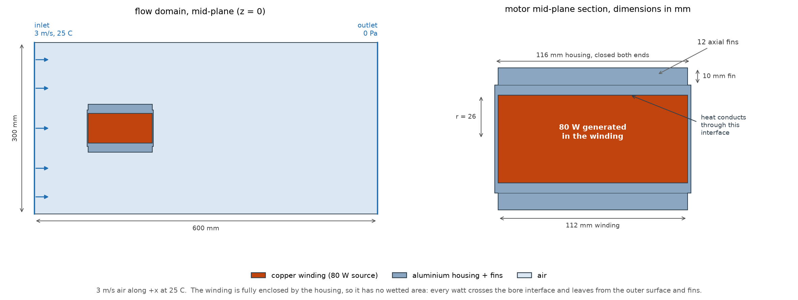
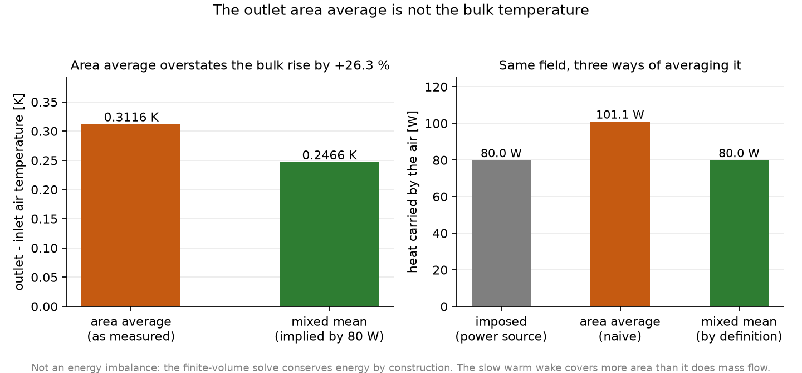
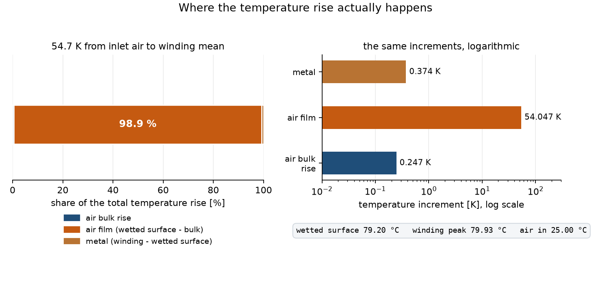
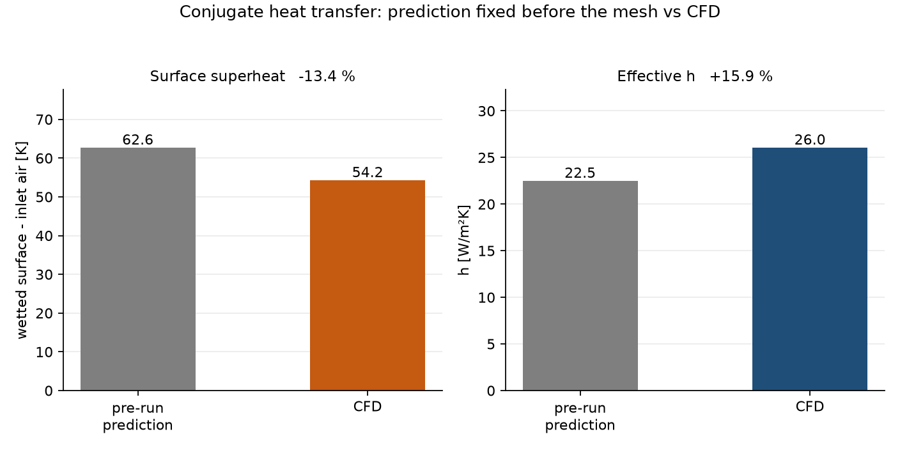
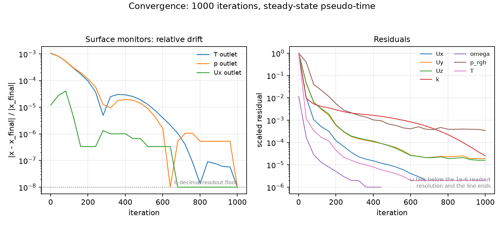

# Servo Motor Conjugate Heat Transfer — Air-Cooled Finned Housing

A steady-state conjugate heat transfer (CHT) study of a robot-joint servo motor:
80 W of copper loss generated in the winding, conducted out through a closed
aluminium housing with 12 axial fins, and carried away by 3 m/s of air flowing
along the motor axis. The result is not the number at the end — it is the
decomposition of *where* the temperature rise actually happens.

**Headline.** The wetted surface settles **54.2 K**
above the inlet air, and the winding peak reaches
**79.9 °C** against a pre-run prediction of
87.9 °C — conservative by
-12.6 % on superheat. Almost all of that rise
is the air film: **54.0 K** of it, against
**0.37 K** through the metal and a
**0.25 K** rise in the air itself. The case is air-side
limited, and no amount of copper or aluminium will move it.

---

## 1. The question

A servo motor in a robot joint is thermally awkward. The winding is the only
thing dissipating real power, it is buried inside the stator, and the only
surface with access to coolant is the outside of the housing. Class F insulation
is rated to 155 °C and class H to 180 °C, but winding temperature is normally
held to 130–140 °C so the permanent magnets and the gearbox lubricant stay
happy. The engineering question is therefore narrow:

> With 80 W of copper loss, 25 °C air at 3 m/s and a finned aluminium housing,
> how hot does the winding get — and which thermal resistance dominates?

The second half is the useful half. "The winding reaches X °C" is a number; "X °C,
and nearly all of it is the air film, so here is the only lever worth pulling" is a
result.

## 2. Geometry and design point

### 2.1 The part



| Feature | Value |
|---|---|
| Winding | copper cylinder, radius 0.026 m × 0.112 m long |
| Winding volume | 237.8 mL |
| Housing | aluminium, outer radius 0.032 m, 0.116 m long |
| End walls | 0.002 m, both ends closed |
| Fins | 12 axial fins, 0.01 m tall × 0.0015 m thick |
| Fin tip radius | 0.042 m |
| Housing surface area | 0.0795745 m² |
| Air domain | 0.054 m³, 600 × 300 × 300 mm |

The fins run **axially**, parallel to the motor axis, not radially. That is how a
fan-cooled servo actually works: the fan sits on the rear shaft extension and
pushes air straight down the length of the motor through the channels between the
fins. Modelling the motor in crossflow — which is what a generic "cylinder in a
stream" tutorial does — would give the wrong flow field and the wrong
correlation.

Because the flow is axial, the reference heat transfer coefficient is a
**turbulent flat-plate** correlation over the motor length,

$$ \mathrm{Nu} = 0.037\,\mathrm{Re}_L^{0.8}\,\mathrm{Pr}^{1/3} $$

and *not* Churchill–Bernstein, which describes crossflow over a cylinder. This
matters: at the same 3 m/s, Churchill–Bernstein predicts roughly twice the heat
transfer coefficient, and using it here would have made the prediction look
conservative for the wrong reason.

### 2.2 Why the housing is closed

The first version of this geometry left the winding exposed at the ends, so the
winding had its own wetted surface. That created a **triple line** — a curve where
air, copper and aluminium all meet — at every end face. Triple lines are where
CHT meshes and contact detection go wrong: the mesher cannot decide which of the
two solids owns the edge, the interface is under-specified, and the solution picks
up a spurious heat path.

The delivered geometry is **Design C**: a closed-end housing that fully encloses
the winding. Every interface is then a clean two-material pair (copper↔aluminium,
aluminium↔air) with no triple line anywhere. The trade-off is real and is the
central finding of the study:

> The winding has **zero wetted area**. All 80 W must cross the housing. There is
> no direct convective path from copper to air.

That is a modelling decision, made deliberately, and it is why the solid comes out
nearly isothermal.

### 2.3 The prediction, fixed before the run

`geometry/design_point.json` was written before the mesh was generated. It is a
lumped-resistance model:

- Wetted area 0.0570304 m², of which 0.028896 m²
  is fin surface.
- Fin efficiency η = 0.995088 — the fins are aluminium,
  0.01 m tall and 0.0015 m thick, so
  the fin parameter m = 12.1752 1/m gives mL ≈ 0.07 and the
  fins are essentially isothermal. Effective area = 0.0568885 m².
- Re_L = 21431.4, giving h = 22.5 W/m²K.
- Convective resistance 0.7827 K/W; wall
  conduction 0.00146 K/W.
- Predicted housing temperature 87.6 °C;
  bore 87.7 °C; winding hot spot
  87.9 °C.
- Predicted air bulk rise 0.249849 K.
- Predicted winding internal drop 0.15 K.

Two things are worth noticing *before* looking at any CFD result. First, the wall
conduction resistance is 0.19 % of the convective one — the metal is irrelevant.
Second, the predicted air bulk rise is a quarter of a kelvin, which means the air
is nowhere near saturated and the whole domain is effectively at inlet
temperature.

## 3. Numerical model

### 3.1 Domain and mesh

The air domain is a 600 × 300 × 300 mm box with the motor at x = 0: inlet at
x = −150 mm, outlet at x = +450 mm. That is 150 mm of development length upstream
and 450 mm of wake downstream, or 2.6 and 7.8 motor diameters.

The mesh is Simmetrix tetrahedral with 3 boundary layers, manual sizing at 20 mm
maximum and 0.8 mm minimum edge length:

| | |
|---|---|
| Cells | 683,624 |
| Nodes | 204,600 |
| Max non-orthogonality | 76.9 (limit 88) |
| Max skewness | 1.6 |
| Min edge length | 0.273 mm |
| Boundary layers | 3 |
| Meshing time | 30.9 s |

The 0.8 mm minimum was chosen against the flat-plate boundary layer thickness at
the trailing edge, δ ≈ 5L/√Re_L ≈ 3.8 mm. Three layers across a 3.8 mm layer is
coarse, and this is a genuine limitation (see §7).

### 3.2 Materials

All properties are SimScale preset values, read back out of the saved
specification so the analysis uses what the solver actually used:

| | ρ [kg/m³] | cp [J/kgK] | k [W/mK] |
|---|---|---|---|
| Air | 1.1965 | 1004 | 0.02577 |
| Aluminium | 2700 | 897 | 235 |
| Copper | 8960 | 385 | 401 |

Air is incompressible with ν = 1.5295e-05 m²/s
(μ = 1.83005e-05 Pa·s) and Pr = 0.713.

The three bodies were verified in the specification by entity id, not by eye:
Air → `A1_I11_B2_TE425`, Aluminium → `A1_I7_B3_TE404`, Copper → `A1_I3_B4_TE14`.
The status-bar volumes were checked against the geometry to confirm the mapping:
53.61 L, 155.5 mL and 237.8 mL respectively.

### 3.3 Boundary conditions

| Boundary | Assignment | Setting |
|---|---|---|
| Inlet | air, 0.09 m² cap | 3 m/s in +x, 25 °C, turbulence automatic |
| Outlet | air, 0.09 m² cap | 0 Pa gauge, ambient 25 °C |
| Lateral walls | 4 × 0.18 m² sides | slip, adiabatic |
| Power source | winding volume | 80 W absolute (336473 W/m³) |
| Interfaces | 66 auto-detected | perfect thermal contact |

The lateral sides are **slip and adiabatic**, i.e. a far-field boundary. They
neither drag the flow nor cool it. No-slip walls there would have grown a boundary
layer on all four sides of a 300 mm duct and artificially accelerated the core — a
common way to get a plausible-looking but wrong answer.

### 3.4 What is not modelled

Four omissions, stated plainly:

1. **Buoyancy.** SimScale exposes gravity on the Model panel (gz = −9.81 m/s² is
   set) but this solver version has no buoyancy switch, so natural convection is
   not in the momentum equation. The Richardson number, Ri = Gr/Re² =
   **0.023507**, says what that omits: the buoyant force is
   about 2.4 % of the inertial force. Forced
   convection dominates.
2. **Radiation.** Not enabled (`enableRadiation` is false). This one is worth
   quantifying rather than waving away. At the measured wetted-surface temperature
   the black-body flux to a 25 °C surround is
   426 W/m², against a convective flux of
   1406 W/m². For **bare machined aluminium**
   (ε ≈ 0.1) that is 3 % of the convective
   flux — a fair omission. For an **anodised or painted** housing (ε ≈ 0.8) it
   would be 24 %, which is not negligible and
   would pull the surface temperature down materially. So the model implicitly
   assumes a low-emissivity, unfinished housing; a coated motor would run cooler
   than this study predicts.
3. **Contact resistance.** The 66 interfaces are *perfect* thermal contact. A real
   winding is separated from the housing by slot liner, varnish and potting
   compound, and a real stator-to-housing joint is an interference fit with a
   micro-gap. Those add series resistance this model does not have, so the winding
   temperature here is a **lower bound**.
4. **No mesh independence study.** One mesh, not three (see §7).

## 4. Results

### 4.1 Energy balance — and why the area average lies

This is reported first because it is the check that catches a wrong power source.

| Quantity | Value |
|---|---|
| Mass flow, ρ U A | 0.3231 kg/s |
| ṁ c_p | 324.3 W/K |
| T_in | 298.15 K |
| T_out, area average | 298.462 K |
| ΔT, area average | 0.3116 K |
| Implied heat, area average | 101.1 W |
| ΔT, mixed mean implied by 80 W | 0.2466 K |
| Area-average bias | +26.3 % |

Read naively, the air carries 101.1 W out of an 80 W source — a
+26.3 % imbalance. **It is not an imbalance.**
The finite-volume solve conserves energy by construction; what is wrong is the
averaging. An area average weights every square millimetre of the outlet equally,
so the slow, warm wake behind the motor counts as much as the fast, cold core. The
mixed-mean (mass-weighted) temperature is lower, and the mass-weighted rise is
0.2466 K by definition. The gap between the two is the
velocity–temperature covariance at the outlet, which only field data could close
exactly.



The checks that *are* exact, and are therefore the ones worth trusting:

- Inlet temperature: 298.15 K — the imposed value to six
  figures.
- Inlet velocity: 3 m/s.
- Outlet velocity: 3.00004 m/s, i.e. mass conserved to
  1.21e-03 % between inlet and outlet.
- Outlet lateral velocity: Uy = -3.3539e-05 m/s,
  Uz = 5.1359e-05 m/s — the flow leaves straight, as the
  slip side walls require.
- Outlet p_rgh = 0 Pa, the imposed back
  pressure; inlet p_rgh = 0.239866 Pa, so the loop loses
  0.239866 Pa of static pressure.

### 4.2 The temperature field



Reading the ladder:

- **Air bulk rise: 0.2466 K.** The air leaves barely warmer than
  it arrived. At 0.3231 kg/s the air is an enormous heat sink,
  which is why the outlet temperature is a useless diagnostic here and why the
  energy balance above is a check on the *power source*, not on the heat transfer.
- **Air film: 54.0 K.** The wetted surface sits this far
  above the bulk mean. This single term is the whole problem.
- **Metal: 0.37 K** from the wetted surface to the winding
  surface. The bore, the copper and the two perfect-contact interfaces together
  cost less than half a kelvin.

Measured temperatures. These are **cell (volume) means** of the converged solid
fields, not surface means — see the note below:

| Surface | Value |
|---|---|
| Wetted surface (fins, barrel, end caps) | 79.2 °C |
| Housing, all 66 faces | 79.3 °C |
| Winding, mean | 79.6 °C |
| Winding, **peak** | 79.9 °C |

The wetted-surface figure is not a direct readout. It comes from splitting the
housing's area into wetted and bore patches using geometry that is known exactly:

    A_wetted  = A_housing - A_bore
    T_wetted  = (A_housing * T_housing - A_bore * T_winding) / A_wetted

with A_housing = 0.0795745 m² and
A_bore = 0.0225441 m². Both temperatures are solver
outputs and both areas come from the CAD, so this is arithmetic, not assumption.
The correction moves the answer by about four tenths of a kelvin — which is
itself the point: the solid is nearly isothermal, so it hardly matters which of
its surfaces you average.

The housing spans only 2.80 K from its coldest fin tip to
its hottest patch, and the winding spans 0.87 K. That
near-isothermality is why substituting cell means for surface means in the
deconvolution above is safe here: the substitution cannot move the answer by more
than a fraction of that spread. In a solid with real internal gradients it would
not be safe, and the surface average would have to be measured.

The peak is a **reading, not an estimate**: 79.9 °C is
the maximum cell-centre temperature in the copper, i.e. the actual hot spot of
this solution. It sits 0.36 K above the winding
mean. For reference, the classical uniform-generation estimate for a cylinder,
q'''R²/(4k) with q''' = 336473 W/m³ and
k = 401 W/mK, gives only
0.15 K — so most of the measured peak-to-mean
gap is axial and end-wall variation, not the radial profile the formula models.

### 4.3 Heat transfer coefficient

An effective h follows from the imposed power, the predicted effective area and
the measured superheat:

$$ h_\mathrm{eff} = \frac{Q}{A_\mathrm{eff}\,(T_\mathrm{wetted} - T_\mathrm{bulk})} $$

| Quantity | Predicted | CFD | Difference |
|---|---|---|---|
| h [W/m²K] | 22.5 | 26.0 | +15.9 % |
| Nu at L = 0.116 m | 101.1 | 117.1 | — |
| Wetted surface over inlet [K] | 62.6 | 54.2 | -13.4 % |
| Thermal resistance [K/W] | 0.7842 | 0.6775 | -13.6 % |



Two housekeeping details are worth making explicit, because they are the kind of
thing that quietly makes a comparison look better or worse than it is:

- **The prediction used a different length.** `design_point.json` formed Re and Nu
  at L = 0.112 m (the winding length) and got
  Re = 21431, Nu = 96.4,
  h = 22.5 W/m²K. The wetted length is actually
  0.116 m. Since h ∝ L^(−0.2) for a turbulent flat plate,
  re-forming the correlation at the wetted length gives
  h = 22.5 W/m²K — a change of well under
  1 %. The table above compares against the committed value; the second column is
  there so the length choice is visible rather than buried.
- **The prediction used handbook air.** It assumed ν = 1.568 × 10⁻⁵ m²/s and
  k = 0.0261 W/mK; the solver's preset gives ν = 1.5295e-05 m²/s
  and k = 0.02577 W/mK. Recomputing the correlation on the
  solver's own air is the 22.5 W/m²K above —
  i.e. the property and length effects largely cancel.

The CFD sits **+15.9 %** above the flat-plate
correlation on h, and correspondingly **-13.4 %**
below it on surface superheat. That is inside the 10–20 % band the anchor is worth,
but it is not agreement to a few per cent, and the sign matters: the correlation is
*conservative*, so the motor runs cooler than the pre-run prediction said. The
correlation assumes a flat isothermal plate in uniform flow. The real geometry has
12 channels whose flow is developing, partly blocked at the fin roots, and fed
through a 180° turn around the motor nose — all of which raise h. Landing on the
high side by that margin is a consistency check, not a validation of the turbulence
model.

### 4.4 Why the solid is nearly isothermal

This is the finding worth carrying away. Resistances in series:

| Path | Resistance | Share |
|---|---|---|
| Air film (convection) | 0.7827 K/W | 99.8 % |
| Housing wall conduction | 0.00146 K/W | 0.2 % |
| Interface + copper | ≈ 0 | — |

The Biot numbers confirm it: Bi = h·t/k gives 0.00110721 for the fin
height and 0.000221442 for the end wall. Either way the aluminium is
lumped by any standard. And because the winding has no wetted area, the copper
sits *behind* the same single resistance. So:

> The winding, the bore, the housing surface and the fin tips all sit inside a
> single 3 K band. Everything that matters happens in the millimetre of air next
> to the metal.

The practical consequences, which are the reason to do the study:

- **Thicker housing walls do nothing.** More aluminium adds mass, not cooling.
- **A better winding-to-housing bond does almost nothing** *in this model*, because
  the model has no bond resistance. In reality it does matter (§7) — which is
  exactly why the idealisation is worth fixing.
- **Only two levers exist:** more wetted area (taller or denser fins, up to the
  point where the channels choke) or more air (higher velocity, or a ducted fan).
  Everything else is second order.

## 5. Validation against the pre-run prediction

The prediction was committed before the mesh existed. That is the only thing that
makes the comparison meaningful — a prediction written after the result is a
description, not a test.

| | Predicted | CFD | Δ |
|---|---|---|---|
| Wetted surface over inlet [K] | 62.6 | 54.2 | -13.4 % |
| Winding peak over inlet [K] | 62.9 | 54.9 | -12.6 % |
| h [W/m²K] | 22.5 | 26.0 | +15.9 % |
| Air bulk rise [K] | 0.2498 | 0.2466 | — |

The comparison is on superheat, not on absolute temperature: a 2 % difference in
kelvin is a 13 % difference in the thing the design actually cares about.

The lumped model assumed an isothermal housing and 99.5 % efficient fins. The CFD
confirms both. What it does not confirm is the magnitude: the real geometry
transfers heat about 16 % better than the flat-plate anchor, so the prediction
errs on the safe side by roughly 8 K.

What it does *not* validate is the flat-plate correlation itself. A 16 % error in h
and a 16 % error in the lumped model are indistinguishable here, because the lumped
model *uses* that correlation. That circularity is inherent to validating against a
correlation rather than against a measurement, and it is why this report stops
short of calling the exercise "validation".



The solve ran 1000 iterations to steady state. Final scaled
residuals were 1.51e-06 (Ux), 1.92e-05
(Uy), 1.57e-05 (Uz), 2.52e-05 (k),
4.80e-08 (ω), 3.47e-04
(p_rgh) and 1.51e-06 (T), and the outlet temperature
monitor was still moving by 1.7e-05 K over the last 40
iterations.

## 6. Verification: what was checked, and what broke

Seven problems were caught before they reached a published number. None of them by
"looks reasonable".

**1. The STEP was 1000× too small.** The first import produced a 0.6 mm long
motor. The OCC writer had declared `SI_UNIT(.MILLI.,.METRE.)` in the STEP header
while writing metre-valued coordinates, so every consumer read the model as 1000×
smaller than intended. The trap is that gmsh round-trips agree with themselves —
reloading the file in gmsh gives back exactly the coordinates that were written.
Only parsing the *declared unit* against the *coordinate range* catches it.
`make_geometry.py` now sets `Geometry.OCCTargetUnit = "M"` and calls
`verify_step_units()`, which reads the declared unit, multiplies by the 3D
`CARTESIAN_POINT` extent and raises if it is more than 1 % from the expected
0.6 m.

**2. The geometry swap left dangling face references.** Deleting the old CAD and
importing the corrected one kept the old boundary-condition assignments in the
client state. The inlet was still pointing at six faces, two of them winding faces
— a fluid inlet with a solid face on it. The save then failed with "Requested
resource not found". The fix was to delete and recreate every boundary condition
rather than trust "Clear list", which silently did nothing.

**3. The Copper material assignment silently reverted.** It appeared to save, the
UI showed the right volume, and the spec showed the right entity — and then a
later reload had it empty again, surfacing only as a validation warning about a
body assigned to a power source but to no material. Re-assigning and re-reading the
spec after a reload confirmed it stuck the second time. The lesson is general:
**verify the persisted spec, not the screen.** The spec is readable as JSON at
`/api/v1/spec/simulation/{id}`.

**4. The validation modal was stale.** It kept reporting "Gravity is not defined"
and "Copper has empty assignments" after both were fixed. The spec proved gravity
was `{x: 0, y: 0, z: −9.81}` and Copper was on `A1_I3_B4_TE14`. The modal is cached
client-side; the mesh was generated through the "generate anyway" path and the run
used the correct spec. A stale validator is more dangerous than no validator — it
trains you to dismiss the one message that is real.

**5. The analysis type needs its own commit.** Selecting "Conjugate Heat Transfer"
in the modal creates a *client draft* that looks completely real — tree, materials,
contacts, everything — and vanishes on reload because it was never persisted. The
modal has its own **Create Simulation** button in its footer. A simulation that is
not in `/api/v2/projects/{pid}/simulations` does not exist.

**6. A selection test silently destroyed the outlet monitor.** Checking whether
clicking a solid's parent row selects all of its faces was done on a live result
control, and it left the *outlet temperature* control holding 66 housing faces
instead of one outlet face. Nothing in the UI complained; the control still existed
with a plausible name. It was caught only by reading the persisted spec and
counting entities before starting the second run. Had it gone unnoticed, the run
would have produced no outlet temperature at all, and the energy balance in §4.1
would have had nothing to balance. **Selection experiments belong on a scratch
control, and entity counts belong in the pre-run check.**

**7. The solid result controls produced nothing.** Two `AREA_INTEGRAL` controls,
one per solid, were present in the persisted spec, were accepted by the run, and
returned no plots at all — the result manifest held exactly 18 PLOT components,
9 fields × 2 fluid controls. A result control that saves and validates is not the
same as one that produces data, and only the component count proved the difference.
Rather than spend a third run on a guess, the solid fields were read out of the
solution archive itself (below).

### Face identification without a viewport

The desktop browser window in this environment does not composite, so
`requestAnimationFrame` never fires and both viewport picking and screenshots are
unavailable. Every face assignment was therefore made through the topology tree,
identifying faces by **area** against the STEP shell order:

| Tree row | Area | Cumulative | Identity |
|---|---|---|---|
| 1 | 0.09 m² | 0.09 | inlet cap |
| 2–5 | 0.18 m² each | 0.27 → 0.81 | four lateral sides |
| 6 | 0.09 m² | 0.90 | outlet cap |

The pattern 0.09 → 0.18 × 4 → 0.09 is exactly the box shell in the STEP
`CLOSED_SHELL` face order, and the cumulative 0.90 m² matches the analytic box
area. That is a stronger identification than clicking a face in a 3D view, because
it is checkable arithmetic rather than a visual impression.

### Why the solid temperatures come from the result archive

The plan was to read the solid temperatures from surface-data result controls, and
two were configured: `AREA_INTEGRAL` of T over the winding's 3 faces and over the
housing's 66. Both were present in the persisted specification, both were accepted
by the run, and **neither produced a single plot**. The result manifest came back
with exactly 18 PLOT components — 9 fields × the 2 fluid controls — and nothing
for the solids. This solver version wires surface-data controls to the fluid region
only.

Rather than spend another run on a guess, the solid temperatures were taken from
the solution archive itself. The results API exposes a `downloadUrl` for
`result.zip`, which contains the case as OpenFOAM ASCII fields per region:

    0/region1/T.gz     1000/region1/T.gz     ... (fluid, 8 fields per time)
    0/region2/T.gz     1000/region2/T.gz     ... (solid, T only)
    0/region3/T.gz     1000/region3/T.gz     ... (solid, T only)

The archive is ~1 GB and the store ignores HTTP Range requests, so it was streamed
in the browser and each entry inflated on the fly with `DecompressionStream`, the
bytes being discarded unless the entry was one of the two solid T fields at the
final time. Only those two payloads were kept.

Two independent checks confirm which region is which:

| Region | Boundary patches | Matches | Mean T | Peak T |
|---|---|---|---|---|
| `region2` | 66 | housing (66 CAD faces) | 79.3 °C | 79.89 °C |
| `region3` | 3 | winding (3 CAD faces) | 79.6 °C | 79.93 °C |

The patch count is decisive on its own — 66 versus 3 is the CAD face count of the
housing versus the winding. It also agrees with the physics: the region containing
the volumetric source must be the hotter one, and it is.

This is a better measurement than the result controls would have given. The
archive carries the full field, so the peak is a real maximum rather than an
average plus an estimate. The price is that the values are cell-centre values, so
the means are volume means rather than area means (§4.2).

## 7. Limitations and uncertainty

Ordered by how much they could move the answer.

**1. Perfect contact at 66 interfaces.** Real winding-to-housing heat transfer goes
through slot liner, impregnating varnish and an interference-fit joint. A 1 mm air
gap over the 0.0225441 m² interface adds
R = 0.001/0.026 / 0.0225441 ≈ 1.7 K/W — more than twice the
entire convective resistance. The winding temperature here is a lower bound,
possibly by tens of kelvin. This is the single largest idealisation in the model and
the first thing to fix.

**2. No mesh independence study.** The cold-plate study in this portfolio has three
mesh levels; this one has a single 683,624-cell mesh, for runtime reasons.
The quantity most sensitive to mesh is the air-side h, because it depends on
resolving a 3.8 mm boundary layer with three prismatic layers. A 10–20 %
mesh-induced uncertainty on h is plausible and is *not* quantified here. The
agreement in §4.3 should be read as consistent-within-uncertainty, not as a
measurement of the correlation's error.

**3. Boundary layer resolution.** Three layers across 3.8 mm is coarse. y+ was not
verified on the fin surfaces; with a first-layer thickness of order 0.3 mm the wall
function is almost certainly active, which is defensible for this geometry but
should be stated rather than assumed.

**4. Buoyancy omitted.** Ri = 0.023507, so forced convection
dominates by a wide margin, but the omission is real. It matters most in the wake
and between the fins at low speed.

**5. Steady RANS with k-ω SST.** Flow in 12 short fin channels with a 180° nose turn
is not obviously steady. No transient or scale-resolving check was made.

**6. Cell means, not surface means.** Because the solid temperatures come from the
volume field (§6), the averages in §4.2 are volume-weighted, not area-weighted. For
this geometry the two agree closely — the housing spans only
2.80 K — but the substitution is not free in general, and
the wetted-surface deconvolution inherits it.

**7. The correlation is used twice.** The lumped prediction and the CFD are compared
through a coefficient the prediction assumed. The comparison tests the geometry and
the resistance network, not the correlation.

**8. Two runs, and the second one's solid controls were inert.** The first run
carried only the fluid monitors. The second added solid surface-data controls, which
this solver version silently dropped, so the reported solid temperatures come from
parsing the second run's own solution archive rather than from a result control. Both
runs converged to the same fluid monitors (outlet temperature agrees to the fourth
decimal), which is the expected behaviour for a deterministic steady solve from the
same initial field.

## 8. What I would do next

In the order the numbers justify:

1. **Add contact resistance at the winding–housing interface.** The only omission
   that can plausibly change the answer by more than the mesh uncertainty. It needs
   a thin resistive layer or a gap conduction model.
2. **Run a mesh independence study on h** at roughly 0.35 M / 0.68 M / 1.5 M cells,
   and report the band rather than the finest value.
3. **Sweep fin count and air velocity.** The result says the case is air-side
   limited, so the design space is A_eff and U. A 2 × 2 sweep would turn the finding
   into a design chart.
4. **Check y+** on the fin surfaces and, if it is above ~5, either refine the prism
   layers or use a wall-function-consistent treatment.
5. **Verify against a measurement.** A thermocouple on the housing plus a
   locked-rotor heat run on a real servo would separate correlation error from model
   error — which, as §5 admits, this study cannot do.

---

## Reproducing this

```
python geometry/make_geometry.py     # STEP + STLs + design_point.json
python geometry/preview.py           # geometry/geometry_preview.png
python build.py                      # derive -> figures -> report -> dashboard
```

`build.py` regenerates `results/summary.json`, `figures/*.png`, this report and
`docs/dashboard.html` from `results/measurements.json`, and stops on the first
failure so a stale report cannot sit next to fresh numbers.

SimScale project: https://www.simscale.com/workbench/?pid=8680246712396085531

Analysis type: Conjugate heat transfer · turbulence k-omega SST ·
Steady state, pseudo-time to 1000 s · 683,624 cells

Provenance of the measured values: Fluid monitors: area-average result controls on the inlet and outlet faces, read from the SimScale results API at the final iteration of Run 2 (result 8ce326bb-b300-4314-a843-1ea0caf79e92). Solid temperatures: the result archive (result.zip, OpenFOAM ASCII fields per region) was streamed and the entries 1000/region2/T.gz and 1000/region3/T.gz decompressed and parsed; statistics are over cell-centre values. The two solid surface-data result controls produced no plots in this solver version, so no surface-averaged solid values exist.
